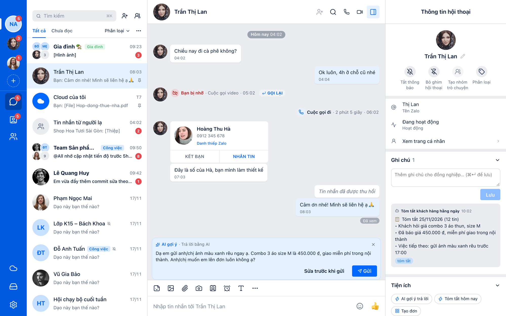
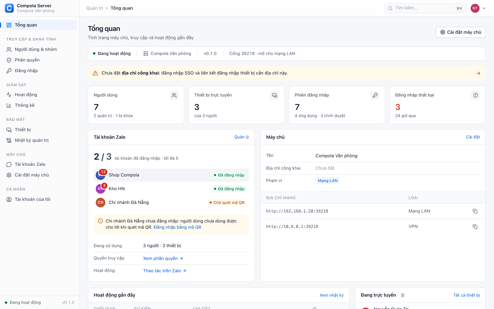
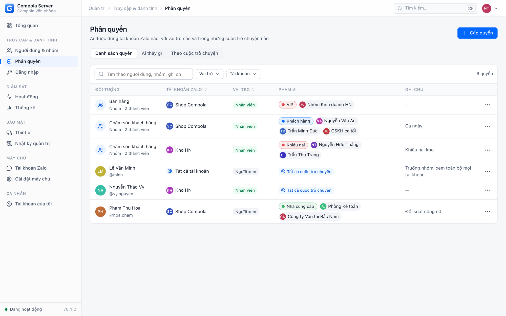
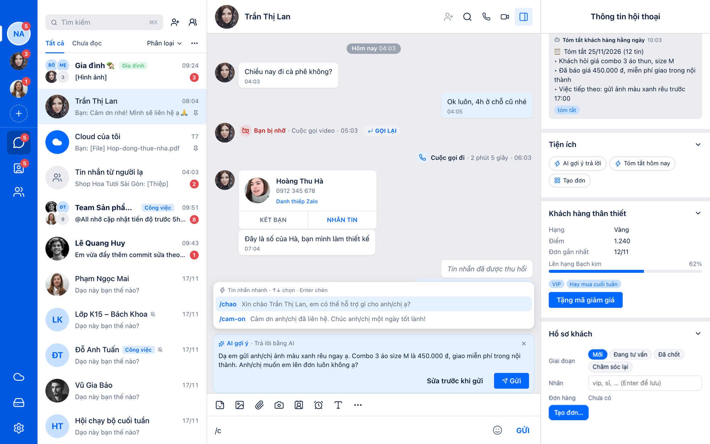
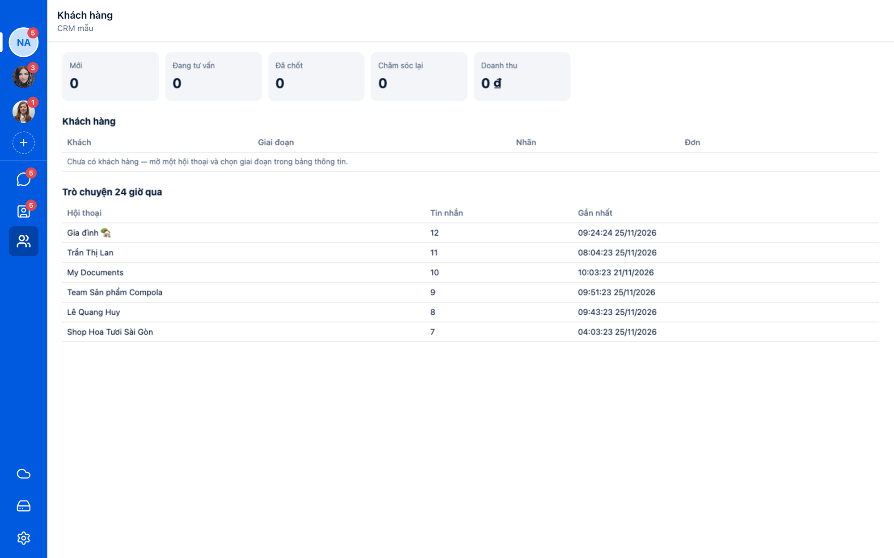

<div align="center">


# Compola

### Zalo cho cả đội — nhanh hơn, gọn hơn, có AI

Một tài khoản Zalo, cả nhóm cùng chăm sóc khách hàng: mỗi người đăng nhập riêng, thấy đúng những cuộc trò chuyện được
giao, có AI gợi ý câu trả lời và tóm tắt khách hàng mỗi ngày.

[](https://github.com/DeanOpen/compola-client/releases/latest/download/Compola-macos-universal.dmg)
[](https://github.com/DeanOpen/compola-client/releases/latest/download/Compola-windows-x64-setup.exe)
[](https://github.com/DeanOpen/compola-client/releases/latest/download/Compola-linux-x86_64.AppImage)

[](https://github.com/DeanOpen/compola-client/releases/latest)
[](https://github.com/DeanOpen/compola-client/releases)


<br />

<picture>
  <source media="(prefers-color-scheme: dark)" srcset="docs/screenshots/hero-dark.png" />
  
</picture>

<sub>Trò chuyện như Zalo PC · AI gợi ý câu trả lời ngay trên ô soạn tin · ghi chú và tóm tắt khách hàng ở bảng bên phải</sub>

</div>

---

## Vì sao chọn Compola

<table>
<tr>
<td width="33%" valign="top">

### 💬 Quen như Zalo PC
Đầy đủ hội thoại, gọi thoại / video, sticker, bình chọn, nhắc hẹn, Cloud của tôi. Chạy chính mã Zalo PC chính thức,
nên tin nhắn và tài khoản của bạn vẫn là của Zalo. Nhanh hơn với ⌘K và phím tắt.

</td>
<td width="33%" valign="top">

### 👥 Một tài khoản, cả đội cùng dùng
**Compola Server** chia sẻ tài khoản Zalo cho nhân viên: mỗi người đăng nhập riêng (mật khẩu, LDAP, SSO), chỉ thấy
những cuộc trò chuyện được giao, mọi thao tác đều được ghi lại.

</td>
<td width="33%" valign="top">

### ✨ AI làm việc cùng bạn
Gợi ý câu trả lời từ lịch sử trò chuyện và thông tin công ty, tự trả lời ngoài giờ, tóm tắt từng khách mỗi ngày thành
ghi chú. Dùng Claude hoặc AI chạy ngay trên máy (Ollama).

</td>
</tr>
<tr>
<td width="33%" valign="top">

### 🗂️ Nhiều tài khoản Zalo
Shop, kho, chi nhánh… tất cả trong một cửa sổ, chuyển tài khoản bằng một cú bấm, mọi tài khoản đều trực tuyến cùng
lúc.

</td>
<td width="33%" valign="top">

### 🧩 Add-on mở rộng
Cài tiện ích từ tệp `.zip`: tin nhắn nhanh `/lệnh`, CRM, báo cáo, nút thao tác, cả giao diện riêng ngay trong ứng
dụng. Mỗi add-on chạy cách ly, có giới hạn, không làm treo ứng dụng.

</td>
<td width="33%" valign="top">

### 🔒 Dữ liệu ở máy của bạn
Không qua máy chủ trung gian của ai: phiên Zalo, tin nhắn và ghi chú nằm trên máy bạn (hoặc máy chủ của công ty bạn).
Tự cập nhật, có chữ ký số.

</td>
</tr>
</table>

## Tải về

| Hệ điều hành | Tải về | Ghi chú |
|---|---|---|
| **macOS** 11+ (Apple silicon & Intel) | [Compola.dmg](https://github.com/DeanOpen/compola-client/releases/latest/download/Compola-macos-universal.dmg) | Mở tệp, kéo Compola vào *Applications*. Nếu macOS hỏi xác nhận ở lần mở đầu: chuột phải vào Compola › *Mở*. |
| **Windows** 10 / 11 (x64) | [Bộ cài .exe](https://github.com/DeanOpen/compola-client/releases/latest/download/Compola-windows-x64-setup.exe) · [.msi](https://github.com/DeanOpen/compola-client/releases/latest/download/Compola-windows-x64.msi) | Chạy bộ cài. Không cần cài thêm gì. |
| **Linux** (x64) | [AppImage](https://github.com/DeanOpen/compola-client/releases/latest/download/Compola-linux-x86_64.AppImage) · [.deb](https://github.com/DeanOpen/compola-client/releases/latest/download/Compola-linux-amd64.deb) · [.rpm](https://github.com/DeanOpen/compola-client/releases/latest/download/Compola-linux-x86_64.rpm) | AppImage: `chmod +x` rồi chạy. |
| **Máy chủ** (Docker, không cần Mac) | `ghcr.io/deanopen/compola-server` | Chạy Compola Server trên Linux; nhân viên dùng ứng dụng hoặc trình duyệt. |

Mở Compola, quét mã QR bằng Zalo trên điện thoại, xong. Ở lần mở đầu, Compola tải bộ Zalo PC chính thức từ VNG và kiểm
tra chữ ký. Ứng dụng **tự cập nhật** (*Cài đặt › Cài đặt chung › Cập nhật*). Mọi phiên bản và ghi chú thay đổi:
[trang phát hành](https://github.com/DeanOpen/compola-client/releases).

## Ảnh màn hình

<table>
<tr>
<td width="50%"></td>
<td width="50%"></td>
</tr>
<tr>
<td align="center"><b>Quản trị Compola Server</b><br /><sub>tài khoản Zalo, người dùng, thiết bị, nhật ký</sub></td>
<td align="center"><b>Phân quyền chi tiết</b><br /><sub>ai được dùng tài khoản nào, vai trò gì, trong cuộc trò chuyện nào</sub></td>
</tr>
<tr>
<td width="50%"></td>
<td width="50%"></td>
</tr>
<tr>
<td align="center"><b>Tin nhắn nhanh, AI và hồ sơ khách</b><br /><sub>gõ <code>/</code> để chèn mẫu, bấm Gửi để dùng gợi ý AI</sub></td>
<td align="center"><b>Add-on có giao diện riêng</b><br /><sub>ví dụ: tab Khách hàng với doanh thu và giai đoạn bán hàng</sub></td>
</tr>
</table>

## Dùng cho cả đội trong 3 bước

1. **Bật máy chủ:** trên Compola đang đăng nhập Zalo, mở *Cài đặt › Compola Server* và bật máy chủ (hoặc chạy image
   Docker `compola-server` trên một máy Linux).
2. **Thêm nhân viên:** trong trang quản trị (`http://<máy-chủ>:39218/admin/`), tạo người dùng hoặc kết nối LDAP / SSO,
   rồi cấp quyền: vai trò *xem* hoặc *thao tác*, cho mọi cuộc trò chuyện hoặc chỉ một số khách / thẻ phân loại.
3. **Nhân viên kết nối:** mở Compola, chọn thẻ *Compola Server* ở màn hình đăng nhập, nhập địa chỉ máy chủ. Hoặc dùng
   ngay trên trình duyệt tại `/web`.

## Câu hỏi thường gặp

<details>
<summary><b>Compola có thay thế Zalo không? Tài khoản của tôi có an toàn không?</b></summary>

Compola chạy chính bộ Zalo PC chính thức của VNG (tải trực tiếp từ VNG, kiểm tra chữ ký), chỉ thay phần giao diện.
Bạn đăng nhập bằng mã QR như Zalo PC; mật khẩu Zalo không bao giờ đi qua Compola. Mọi dữ liệu nằm trên máy của bạn.
</details>

<details>
<summary><b>AI có đọc tin nhắn của tôi không?</b></summary>

Chỉ khi bạn bật. AI tắt mặc định; khi bật, chỉ add-on bạn cho phép mới gửi đoạn hội thoại cần thiết tới nhà cung cấp AI
bạn chọn (Claude, hoặc mô hình chạy ngay trên máy qua Ollama để dữ liệu không rời máy).
</details>

<details>
<summary><b>Nhân viên có thấy hết tin nhắn của công ty không?</b></summary>

Không. Mỗi người chỉ thấy những cuộc trò chuyện hoặc thẻ phân loại được cấp; người chỉ có quyền *xem* không gửi được
tin nhắn. Mọi thao tác được ghi theo từng người.
</details>

<details>
<summary><b>Có tốn phí không?</b></summary>

Compola miễn phí tải về. Nếu dùng AI của Claude, bạn trả phí trực tiếp cho Anthropic theo mức dùng; dùng Ollama trên máy
thì không tốn phí.
</details>

---

## Dành cho nhà phát triển

Rust + Tauri 2 · React 19 · bản chuyển từ `zalo-swift-re`. Tài liệu chi tiết nằm trong [`docs/`](docs).

<details>
<summary><b>Cách hoạt động</b></summary>

```
┌──────────────────────────── Compola.app ────────────────────────────┐
│                                                                     │
│  Cửa sổ giao diện (React, src/)   Lõi Rust (src-tauri/)             │
│  ─ chat, cài đặt, quản trị ◀────▶ ─ preload + thay main process     │
│                            Tauri  ─ proxy mạng, cookie, cache media │
│                                   ─ thông báo, cuộc gọi, sqlite     │
│                                   ─ Compola Server (remote/)        │
│                                        ▲                            │
│  Webview renderer chạy ẩn ─────────────┘                            │
│  (renderer Zalo PC chính thức, tải từ VNG ở lần mở đầu tiên)        │
└─────────────────────────────────────────────────────────────────────┘
         ▲ HTTP / WebSocket (Compola Server)
         │
  Ứng dụng Compola kết nối · trang quản trị (/admin) · bản web (/web)
```

- **Renderer Zalo PC chính thức** chạy trong một webview ẩn. Rust đóng vai phần preload và main process của Electron
  trong ứng dụng thật (`bridge-table.json` ghép từng thành phần bridge với kênh IPC của nó).
- **Cửa sổ giao diện** không nói chuyện trực tiếp với Zalo. Nó đọc trạng thái của renderer qua Rust và tải media qua
  scheme `compola-media`, với header, cookie và dấu vân tay TLS của ứng dụng chính thức (`docs/media.md`).
- **Fingerprint helper** (`fingerprint-helper/`, Go) là tiến trình đi kèm, giúp các yêu cầu gửi ra có dấu vân tay TLS
  của Chromium.
- **Compola Server** nằm ngay trong ứng dụng. Một Compola *máy chủ* phục vụ tài khoản qua HTTP/WebSocket; các ứng dụng
  *kết nối* đăng nhập vào đó thay vì chạy bộ máy Zalo riêng. Trên Linux, cả máy chủ chạy trong một container
  (`deploy/server/`).
</details>

<details>
<summary><b>Cấu trúc mã nguồn</b></summary>

| Đường dẫn | Nội dung |
|---|---|
| `src/` | Giao diện (React + Vite): `shell/` (cửa sổ, thanh bên), `features/` (trò chuyện, hội thoại, cài đặt, tài khoản, add-on, remote …), `engine/` (trạng thái và lời gọi backend; `mock/` để phát triển trên trình duyệt), `ui/`, `styles/` |
| `src-tauri/src/` | Lõi Rust: `engine.rs`, `main_process.rs`, `bridge/`, `host/`, `net/`, `media/`, `notifications/`, `calls/`, `downloads.rs`, `installer.rs` (tải và kiểm tra bộ Zalo), `account.rs` (nhiều tài khoản), `automation/` (MCP, lịch, tìm kiếm, add-on, AI), `remote/` (Compola Server), `updater.rs` |
| `admin/` | Trang quản trị Compola Server (React + Vite), build vào `src-tauri/admin-dist/` và nhúng vào ứng dụng |
| `fingerprint-helper/` | Tiến trình đi kèm (Go) tạo dấu vân tay TLS |
| `scripts/` | `make-app.sh`, `release.sh`, `build-fingerprint-helper.sh`, `pack-addon.sh` |
| `deploy/` | Image máy chủ Linux (`server/`), gateway (`gateway/`), Docker Compose và Helm chart |
| `examples/addons/` | Add-on mẫu |
| `docs/` | Tài liệu thiết kế, ảnh màn hình và tham khảo giao diện |
</details>

<details>
<summary><b>Chạy khi phát triển</b></summary>

Cần macOS 11+, Rust (stable), Node.js + npm, Xcode command line tools; Go cho fingerprint helper (không có Go vẫn build
được, nhưng yêu cầu dùng dấu vân tay TLS của reqwest).

```sh
npm install
npx tauri dev
```

Muốn dùng Zalo đã cài sẵn thay vì tải về: `COMPOLA_ZALO_APP=/Applications/Zalo.app`. Mỗi thư mục dữ liệu chỉ chạy được một
Compola: bản dev và bản đã cài dùng chung `~/Library/Application Support/Compola`, nên thoát một bản trước khi mở bản
kia, hoặc cho bản dev thư mục riêng bằng `COMPOLA_DATA_DIR`.

Chỉ giao diện, trên trình duyệt, với dữ liệu giả (không cần Rust hay tài khoản Zalo):

```sh
npm run dev                    # http://localhost:1420/?mock=1
npm run dev:admin              # http://localhost:1430/admin/?mock=1  (đăng nhập bằng admin, lan hoặc minh)
```

Phát triển Compola Server mà không động vào phiên Zalo thật:

```sh
COMPOLA_DATA_DIR=/tmp/compola-host \
COMPOLA_ZALO_APP="$HOME/Library/Application Support/Compola/ZaloRuntime/current" \
COMPOLA_SERVER_ADMIN=admin:changeme \
npx tauri dev
```

`COMPOLA_SERVER_ADMIN` (chỉ bản debug) tạo sẵn tài khoản quản trị. Build trang quản trị trước khi chạy Cargo, nếu không
`/admin` sẽ trống: `npm run build:admin`. Thiết kế đầy đủ: `docs/compola-server.md`.
</details>

<details>
<summary><b>Viết add-on</b></summary>

Add-on là tệp `.zip` gồm `manifest.json`, `main.js` và (tuỳ chọn) giao diện HTML. Mỗi add-on chạy trong vùng cách ly
QuickJS riêng trong lõi Compola, có giới hạn bộ nhớ, thời gian xử lý, số tin gửi và lượng dùng AI; tự khởi động lại khi
lỗi. Add-on có thể viết ghi chú, gợi ý câu trả lời, thêm tin nhắn nhanh và nút thao tác, dùng AI, lịch, MCP, HTTP tới địa
chỉ được cho phép, và hiển thị giao diện HTML riêng (tab, mục trong bảng thông tin, thanh trên ô soạn tin, trang cài đặt,
hộp thoại).

Tài liệu: [`docs/addons.md`](docs/addons.md). Ví dụ: `examples/addons/crm-demo`, đóng gói bằng
`scripts/pack-addon.sh examples/addons/crm-demo`.
</details>

<details>
<summary><b>Kiểm thử</b></summary>

```sh
npx tsc --noEmit               # kiểm tra kiểu của giao diện
npm run build && npm run build:admin
cd src-tauri && cargo test --lib
```

Một số bài kiểm thử bộ cài mặc định bị bỏ qua vì cần bộ cài Zalo chính thức trên máy:
`COMPOLA_ZALO_DMG=/đường/dẫn/ZaloSetup.dmg cargo test -- --ignored` (macOS), hoặc
`COMPOLA_ZALO_WIN_SETUP=/đường/dẫn/ZaloSetup-26.10.20.exe cargo test -- --ignored` (Windows).
</details>

<details>
<summary><b>Đóng gói và phát hành</b></summary>

```sh
scripts/make-app.sh                 # src-tauri/target/release/bundle/macos/Compola.app
scripts/make-app.sh --dmg           # + bundle/dmg/Compola_<version>_<arch>.dmg
scripts/make-app.sh --universal     # arm64 + x86_64
```

Cấu hình đóng gói: `src-tauri/tauri.conf.json` (`bundle.macOS`: bundle id `app.compola.desktop`, hardened runtime,
`signingIdentity: "-"` ký ad hoc cho bản trên máy), `src-tauri/Entitlements.plist` (JIT, micro và camera cho
`ZaloCall`), `src-tauri/Info.plist`, `bundle.externalBin` (fingerprint helper).

**Phát hành:** đẩy một tag, GitHub Actions build cho macOS (DMG universal + zip), Windows (NSIS + MSI), Linux (deb, rpm,
AppImage), gói cập nhật có chữ ký, `latest.json` và `SHA256SUMS.txt`:

```sh
git tag v0.2.0 && git push origin v0.2.0
```

Mỗi lần push lên `main` làm mới bản thử nghiệm `edge`. Ứng dụng tự cập nhật (`src-tauri/src/updater.rs`): bản phát hành
theo bản `v*` mới nhất, bản edge theo `edge`; kiểm tra 20 giây sau khi mở rồi mỗi giờ, dù đã đăng nhập Zalo hay chưa.
Gói cập nhật được ký bằng secret `TAURI_SIGNING_PRIVATE_KEY`.

| Workflow | Khi nào | Làm gì |
|---|---|---|
| `ci.yml` | mỗi push lên `main` và pull request | kiểm tra kiểu, build giao diện + quản trị + bản web, `cargo test --lib`, Helm lint, image gateway |
| `release.yml` | tag `v*`; mỗi push lên `main` (bản `edge`) | gói cài cho 3 hệ điều hành, gói cập nhật, `latest.json` |
| `server-image.yml` | `main` và tag `v*` | image `ghcr.io/deanopen/compola-server` (Compola Server trên Linux) |
| `docker.yml` | `main` và tag `v*` | image gateway `ghcr.io/<owner>/compola-gateway` |

**Ký bản macOS:** không có secret của Apple thì bản macOS chỉ được ký ad hoc. Khi có, `release.yml` chạy
`scripts/release.sh`: ký Developer ID, công chứng và gắn kết quả cho ứng dụng và DMG. Secret cần có:
`APPLE_CERTIFICATE` (tệp `.p12` Developer ID Application, base64), `APPLE_CERTIFICATE_PASSWORD`, tuỳ chọn
`APPLE_SIGNING_IDENTITY`; công chứng bằng khoá API App Store Connect (`APPLE_API_KEY`, `APPLE_API_ISSUER`,
`APPLE_API_KEY_P8`) hoặc Apple ID (`APPLE_ID`, `APPLE_PASSWORD`, `APPLE_TEAM_ID`). Ký và công chứng trên máy:

```sh
APPLE_SIGNING_IDENTITY="Developer ID Application: <Tên> (<TEAMID>)" scripts/release.sh
```

`COMPOLA_VERSION=x.y.z` thay phiên bản; `COMPOLA_SKIP_NOTARIZE=1` chỉ ký, không công chứng.
</details>

<details>
<summary><b>Triển khai máy chủ (Docker, Kubernetes) — không cần Mac</b></summary>

Compola Server chạy trên Linux: container `compola-server` chứa bộ máy Zalo, API, trang quản trị và bản web; gateway
`compola-gateway` (Caddy) đứng trước, cấp HTTPS tự động.

```sh
cp deploy/.env.example deploy/.env       # đặt COMPOLA_ADMIN; với HTTPS thêm SITE_ADDRESS và COMPOLA_PUBLIC_URL
docker compose -f deploy/docker-compose.yml --env-file deploy/.env up -d

helm install compola https://github.com/DeanOpen/compola-client/releases/latest/download/compola-helm.tgz \
  --set server.admin='admin:<mật-khẩu>' --set ingress.enabled=true --set 'ingress.hosts[0].host=compola.example.com'
```

Mở `/admin/`, đăng nhập bằng `COMPOLA_ADMIN`, rồi quét mã QR Zalo trong *Tài khoản Zalo*. Gateway cũng có thể đứng
trước một máy cài ứng dụng Compola làm máy chủ (macOS, Windows hoặc Linux). Chi tiết:
[`deploy/README.md`](deploy/README.md).
</details>

<details>
<summary><b>Biến cấu hình</b></summary>

| Biến | Tác dụng |
|---|---|
| `COMPOLA_ZALO_APP` | Dùng Zalo.app này (hoặc bộ runtime đã giải nén) thay vì tải về |
| `COMPOLA_DATA_DIR` | Thư mục dữ liệu thay cho `~/Library/Application Support/Compola` (chạy nhiều bản cùng lúc) |
| `COMPOLA_DEBUG=1` | Nhật ký gỡ lỗi; `COMPOLA_DEBUG_RESPONSES=1` ghi cả nội dung phản hồi |
| `COMPOLA_SHOW_RENDERER=1` | Hiện các cửa sổ renderer Zalo đang chạy ẩn |
| `COMPOLA_NO_FINGERPRINT_HELPER=1` | Không khởi động tiến trình dấu vân tay TLS |
| `COMPOLA_NO_SHARED_WORKER=1`, `COMPOLA_TRACE_WORKERS=1` | Tắt / theo dõi shared worker của renderer |
| `COMPOLA_STORAGE` | Ép kiểu lưu trữ của renderer |
| `COMPOLA_QR_OUT=<tệp.png>` | Ghi thêm mã QR đăng nhập ra tệp (đăng nhập không cần giao diện) |
| `COMPOLA_SERVER_ADMIN=user:pass` | Bản debug: tạo tài khoản quản trị Compola Server khi khởi động |
| `COMPOLA_HEADLESS=1`, `COMPOLA_ADMIN=user:pass`, `COMPOLA_PORT` | Chế độ máy chủ không giao diện (container Linux) |
| `COMPOLA_DISABLE_UPDATER=1` | Tắt tự cập nhật |
</details>

<details>
<summary><b>Tài liệu</b></summary>

| Tài liệu | Nội dung |
|---|---|
| [`docs/compola-server.md`](docs/compola-server.md) | Compola Server: khái niệm, HTTP API, chính sách quyền, theo dõi hoạt động, bản web |
| [`docs/multi-account.md`](docs/multi-account.md) | Nhiều tài khoản Zalo: mô hình tài khoản, cách ly, giao diện và máy chủ |
| [`docs/addons.md`](docs/addons.md) | Add-on: gói cài, vùng cách ly, API, giao diện HTML, add-on có sẵn, nhà cung cấp AI |
| [`docs/automation.md`](docs/automation.md) | Máy chủ MCP, lịch tự động, tìm kiếm |
| [`docs/media.md`](docs/media.md) | Scheme `compola-media`: cách giao diện tải media của Zalo |
| [`docs/zalo-pc-style.md`](docs/zalo-pc-style.md) | Các quyết định về giao diện (phong cách Zalo PC) |
</details>

## Dữ liệu, quyền riêng tư và mã của bên thứ ba

- Compola giữ mọi thứ trên máy của bạn (`~/Library/Application Support/Compola` trên macOS): bộ Zalo, cookie phiên đăng
  nhập, bộ đệm, danh sách tài khoản và, với máy chủ, cơ sở dữ liệu Compola Server. Không thứ gì trong số này nằm trong
  repository.
- **Bộ Zalo PC là phần mềm của VNG.** Compola tải nó từ VNG ở lần mở đầu tiên và kiểm tra chữ ký; nó không bao giờ được
  đóng gói kèm hay commit vào đây.
- Compola không liên kết với VNG hay Zalo. Đây là dự án riêng, không có tệp giấy phép; mọi quyền được bảo lưu trừ khi ghi
  khác.
