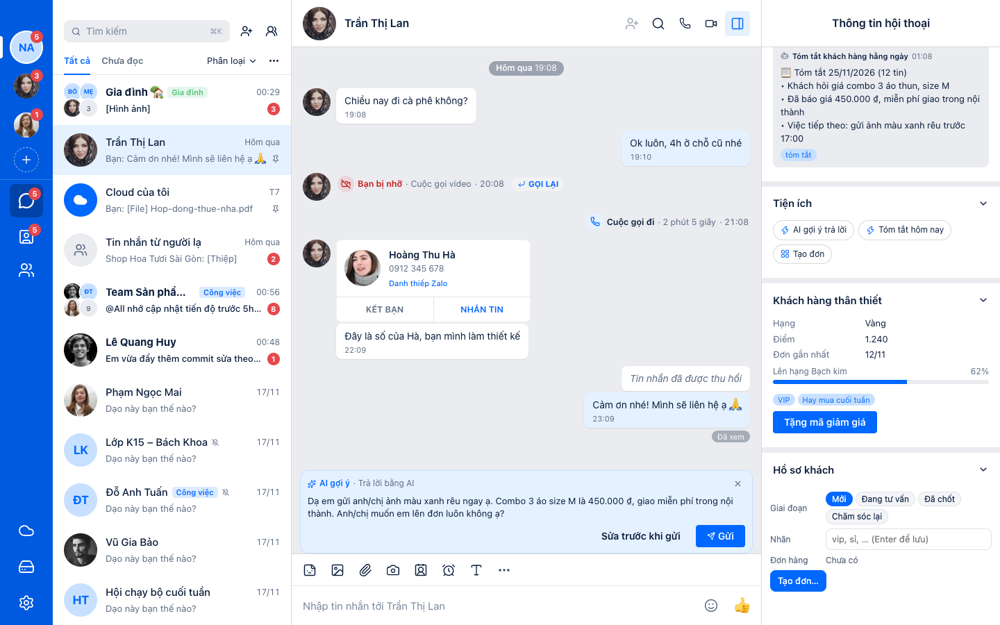
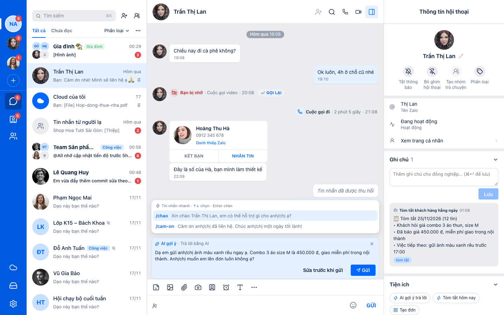
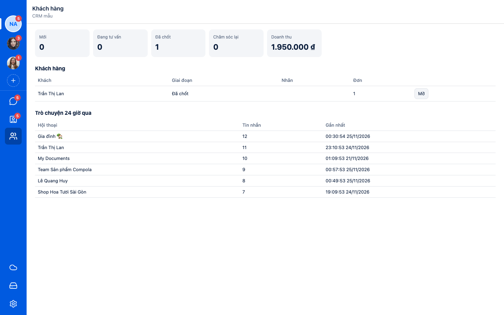
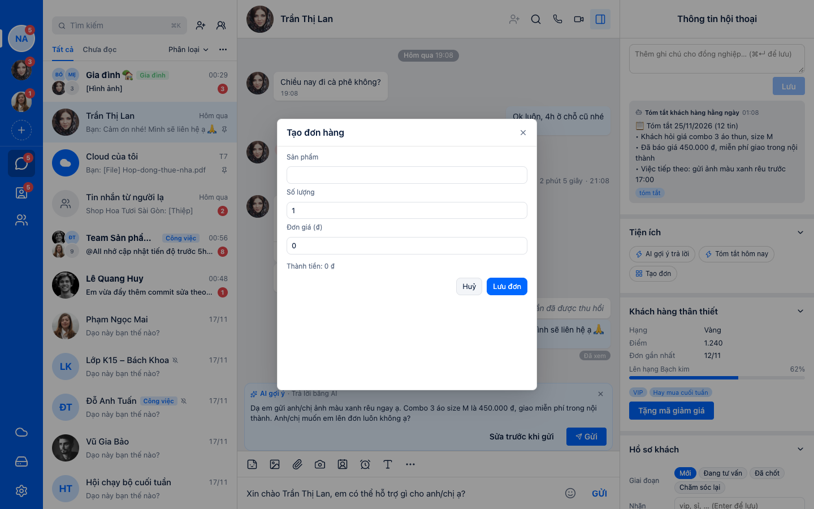

# Compola

**Ứng dụng Zalo gốc cho macOS, làm cho làm việc nhóm.** Compola chạy ẩn bộ máy Zalo PC chính thức và đặt lên trên một
giao diện nhanh, dùng tốt bằng bàn phím. Compola còn có **Compola Server**: một Compola chia sẻ tài khoản Zalo của mình
cho nhân viên, mỗi người có tài khoản đăng nhập, vai trò và phạm vi hội thoại riêng, quản lý qua trang quản trị trên web.

Rust + Tauri 2 · React 19 · macOS 11+ (Apple silicon và Intel) · bản chuyển từ `zalo-swift-re`

---

## Mục lục

- [Tính năng](#tính-năng)
- [Cách hoạt động](#cách-hoạt-động)
- [Cấu trúc mã nguồn](#cấu-trúc-mã-nguồn)
- [Bắt đầu](#bắt-đầu)
- [Add-on](#add-on)
- [Compola Server](#compola-server)
- [Kiểm thử](#kiểm-thử)
- [Đóng gói ứng dụng](#đóng-gói-ứng-dụng)
- [Phát hành](#phát-hành)
- [CI và phát hành trên GitHub](#ci-và-phát-hành-trên-github)
- [Triển khai gateway (Docker, Kubernetes)](#triển-khai-gateway-docker-kubernetes)
- [Biến cấu hình](#biến-cấu-hình)
- [Tài liệu](#tài-liệu)
- [Dữ liệu, quyền riêng tư và mã của bên thứ ba](#dữ-liệu-quyền-riêng-tư-và-mã-của-bên-thứ-ba)

## Tính năng

**Ứng dụng nhắn tin**
- Giao diện và cách dùng như Zalo PC: hội thoại, trò chuyện, cảm xúc, trả lời, ghim, bình chọn, nhắc hẹn, sticker,
  Cloud của tôi, kho ảnh / tệp / liên kết, danh bạ, tạo nhóm và thành viên nhóm.
- Đăng nhập bằng mã QR, thông báo của hệ thống, gọi thoại / video qua trình gọi của Zalo, chuyển và tải tệp.
- Chuyển nhanh hội thoại bằng ⌘K, bảng lệnh và các thao tác khi rê chuột lên tin nhắn.
- **Nhiều tài khoản Zalo** trong một ứng dụng, chuyển tài khoản ngay trên thanh bên (`docs/multi-account.md`).

**Compola Server (chia sẻ một tài khoản cho cả nhóm)**
- Mỗi người đăng nhập riêng: mật khẩu cục bộ (argon2id), **LDAP / Active Directory** và **SSO** (OpenID Connect,
  OAuth 2).
- Phân quyền theo vai trò: *viewer* (chỉ xem) hoặc *agent* (xem và thao tác), áp dụng cho mọi hội thoại hoặc chỉ những
  hội thoại và thẻ phân loại Zalo được chọn, cấp cho từng người hoặc nhóm người.
- Đăng nhập thiết bị cho ứng dụng kết nối vào máy chủ, quản lý phiên và đăng xuất từ xa.
- Nhật ký kiểm tra, theo dõi hoạt động và thống kê theo từng người, đều xuất được CSV.
- **Trang quản trị** tại `/admin` (người dùng và nhóm, phân quyền, cách đăng nhập, thiết bị, nhật ký, hoạt động, thống
  kê, tài khoản Zalo và cài đặt máy chủ), có giao diện sáng và tối. Nhân viên cũng có thể dùng bản web tại `/web`.

**Tự động hoá**
- Máy chủ MCP để các ứng dụng AI đọc và thao tác trên Compola, lịch tự động (cron) và add-on (`docs/automation.md`).
- Add-on cài từ tệp `.zip`: trả lời bằng AI, tóm tắt khách hàng hằng ngày thành ghi chú, tin nhắn nhanh, và giao diện
  HTML riêng (tab, bảng, hộp thoại). Mỗi add-on chạy trong vùng cách ly có giới hạn ([Add-on](#add-on),
  `docs/addons.md`).

## Cách hoạt động

```
┌──────────────────────────── Compola.app ────────────────────────────┐
│                                                                     │
│  Cửa sổ giao diện (React, src/)   Lõi Rust (src-tauri/)             │
│  ─ chat, cài đặt, quản trị ◀────▶ ─ preload + thay main process     │
│                            Tauri  ─ proxy mạng, cookie, cache media │
│                                   ─ thông báo, cuộc gọi, sqlite     │
│                                   ─ Compola Server (remote/)        │
│                                        ▲                            │
│  Webview renderer chạy ẩn ─────────────┘                            │
│  (renderer Zalo PC chính thức, tải từ VNG ở lần mở đầu tiên)        │
└─────────────────────────────────────────────────────────────────────┘
         ▲ HTTP / WebSocket (Compola Server)
         │
  Ứng dụng Compola kết nối · trang quản trị (/admin) · bản web (/web)
```

- **Renderer Zalo PC chính thức** chạy trong một webview ẩn. Rust đóng vai phần preload và main process của Electron
  trong ứng dụng thật (`bridge-table.json` ghép từng thành phần bridge với kênh IPC của nó).
- **Cửa sổ giao diện** không bao giờ nói chuyện trực tiếp với Zalo. Nó đọc trạng thái của renderer qua Rust và tải
  media qua scheme `compola-media`, scheme này tải với header, cookie và dấu vân tay TLS của ứng dụng chính thức
  (`docs/media.md`).
- **Fingerprint helper** (`fingerprint-helper/`, Go) là tiến trình đi kèm, giúp các yêu cầu gửi ra có dấu vân tay TLS
  của Chromium.
- **Compola Server** nằm ngay trong ứng dụng. Một Compola *máy chủ (host)* phục vụ tài khoản của nó qua
  HTTP/WebSocket; các ứng dụng *kết nối (joined)* đăng nhập vào đó thay vì chạy bộ máy Zalo của riêng mình.

## Cấu trúc mã nguồn

| Đường dẫn | Nội dung |
|---|---|
| `src/` | Giao diện (React + Vite): `shell/` (cửa sổ, thanh bên), `features/` (trò chuyện, hội thoại, cài đặt, tài khoản, remote …), `engine/` (trạng thái và lời gọi backend; `mock/` để phát triển chỉ trên trình duyệt), `ui/` (thành phần dùng chung), `styles/` |
| `src-tauri/src/` | Lõi Rust: `engine.rs`, `main_process.rs`, `bridge/`, `host/`, `net/`, `media/`, `notifications/`, `calls/`, `downloads.rs`, `installer.rs` (tải và kiểm tra bộ Zalo), `account.rs` (nhiều tài khoản), `automation/`, `remote/` (Compola Server) |
| `admin/` | Trang quản trị Compola Server (React + Vite), build vào `src-tauri/admin-dist/` và nhúng vào ứng dụng |
| `fingerprint-helper/` | Tiến trình đi kèm (Go) tạo dấu vân tay TLS |
| `scripts/` | `make-app.sh`, `release.sh`, `build-fingerprint-helper.sh`, `pack-addon.sh` |
| `deploy/` | Image gateway (`gateway/`), Docker Compose và Helm chart (`helm/compola-gateway/`) |
| `examples/addons/` | Add-on mẫu |
| `.github/workflows/` | CI, phát hành và image gateway |
| `docs/` | Tài liệu thiết kế và tham khảo giao diện (xem [Tài liệu](#tài-liệu)) |

## Bắt đầu

### Yêu cầu

- macOS 11 trở lên
- Rust (stable), Node.js + npm, Xcode command line tools
- Go, để build fingerprint helper. Không có Go thì vẫn build được, nhưng các yêu cầu sẽ dùng dấu vân tay TLS của
  reqwest thay vì của Chromium.

### Chạy khi phát triển

```sh
npm install
npx tauri dev
```

Ở lần mở đầu tiên, Compola tải bộ Zalo PC chính thức từ VNG và kiểm tra chữ ký. Muốn dùng Zalo đã cài sẵn trên máy thì
đặt `COMPOLA_ZALO_APP=/Applications/Zalo.app`.

`src-tauri/build.rs` tự build fingerprint helper cho máy bạn ở lần đầu (`scripts/build-fingerprint-helper.sh`).

> Mỗi thư mục dữ liệu chỉ chạy được một Compola: bản dev và bản đã cài dùng chung
> `~/Library/Application Support/Compola`. Hãy thoát một bản trước khi mở bản kia, hoặc cho bản dev thư mục riêng bằng
> `COMPOLA_DATA_DIR`.

### Chỉ giao diện, trên trình duyệt (dữ liệu giả)

Không cần Rust, không cần tài khoản Zalo:

```sh
npm run dev                    # http://localhost:1420/?mock=1
npm run dev:admin              # http://localhost:1430/admin/?mock=1  (đăng nhập bằng admin, lan hoặc minh)
```

Khi không chạy trong Tauri, giao diện tự chuyển sang backend giả (mock).

## Add-on

Add-on mở rộng Compola bằng mã và giao diện. Cài tệp `.zip` tại *Cài đặt › Nâng cao › Add-on › Cài từ tệp .zip…*. Trước
khi cài, bạn thấy các quyền mà add-on yêu cầu. Có sẵn (tắt cho đến khi bạn bật): **Trả lời bằng AI** (gợi ý câu trả
lời, hoặc tự trả lời và chuyển cho người thật khi cần), **Tóm tắt khách hàng hằng ngày** (ghi chú tóm tắt bằng AI cho
mỗi hội thoại trong ngày) và **Tin nhắn nhanh** (mẫu trả lời gõ bằng `/lệnh`). Nhà cung cấp AI (Claude hoặc máy chủ
tương thích OpenAI như Ollama) được cài một lần ngay trên trang đó.

Mỗi add-on chạy trong lõi Compola, trong vùng cách ly QuickJS riêng, có giới hạn bộ nhớ, thời gian xử lý, số tin nhắn
gửi và lượng dùng AI. Add-on tự khởi động lại khi lỗi và bị tạm dừng nếu lỗi liên tục. Add-on có thể:
- viết **ghi chú** cho hội thoại và **gợi ý câu trả lời** phía trên ô soạn tin;
- hiển thị **giao diện HTML riêng** dưới dạng tab ở thanh bên, mục trong bảng thông tin hội thoại, thanh phía trên ô
  soạn tin, trang cài đặt của nó hoặc hộp thoại (iframe cách ly, chỉ nói chuyện với add-on của nó);
- thêm tin nhắn nhanh, nút thao tác và bảng thông tin, dùng AI, lịch tự động, máy chủ MCP và HTTP tới các địa chỉ được
  cho phép.

| Bảng thông tin hội thoại: ghi chú, thao tác, bảng và giao diện HTML | Gợi ý trả lời và tin nhắn nhanh `/` |
|---|---|
|  |  |
| **Tab của add-on (HTML)** | **Hộp thoại của add-on (HTML)** |
|  |  |

Tự viết add-on: xem `docs/addons.md` (manifest, API, giao diện, quyền) và ví dụ `examples/addons/crm-demo`, đóng gói
bằng `scripts/pack-addon.sh examples/addons/crm-demo`.

## Compola Server

1. **Máy chủ:** trên Compola đang đăng nhập Zalo, mở *Cài đặt › Compola Server*, bật máy chủ, chọn cổng và có cho mạng
   LAN kết nối hay không. Mở trang quản trị (`http://<máy-chủ>:<cổng>/admin/`) và đặt địa chỉ công khai của máy chủ
   trong *Cài đặt máy chủ*.
2. **Người dùng:** thêm người dùng (hoặc kết nối LDAP / SSO trong *Đăng nhập*), rồi cấp quyền trong *Phân quyền*: một
   vai trò kèm phạm vi hội thoại hoặc thẻ phân loại, cho một người hoặc một nhóm.
3. **Ứng dụng kết nối:** trên một Compola khác, mở thẻ *Compola Server* ở màn hình đăng nhập, nhập địa chỉ và đăng nhập.
   Với SSO, ứng dụng hiện một mã để người dùng xác nhận trên trình duyệt.

Mọi thao tác của người kết nối đều qua chính sách của máy chủ (`src-tauri/src/remote/policy.rs`) và được ghi nhật ký.
Thiết kế đầy đủ và giao thức HTTP nằm trong `docs/compola-server.md`.

Để phát triển phần máy chủ mà không động vào phiên Zalo thật, chạy thêm một bản với thư mục dữ liệu riêng:

```sh
COMPOLA_DATA_DIR=/tmp/compola-host \
COMPOLA_ZALO_APP="$HOME/Library/Application Support/Compola/ZaloRuntime/current" \
COMPOLA_SERVER_ADMIN=admin:changeme \
npx tauri dev
```

`COMPOLA_SERVER_ADMIN` (chỉ bản debug) tạo sẵn tài khoản quản trị đó khi khởi động. Hãy build trang quản trị trước khi
chạy Cargo, nếu không `/admin` sẽ trống: `npm run build:admin`.

## Kiểm thử

```sh
npx tsc --noEmit               # kiểm tra kiểu của giao diện
npm run build && npm run build:admin
cd src-tauri && cargo test --lib
```

Một số bài kiểm thử bộ cài mặc định bị bỏ qua vì cần bộ cài Zalo chính thức trên máy:
`COMPOLA_ZALO_DMG=/đường/dẫn/ZaloSetup.dmg cargo test -- --ignored` (bản macOS), hoặc
`COMPOLA_ZALO_WIN_SETUP=/đường/dẫn/ZaloSetup-26.10.20.exe cargo test -- --ignored` (bản Windows).

## Đóng gói ứng dụng

```sh
scripts/make-app.sh                 # src-tauri/target/release/bundle/macos/Compola.app
scripts/make-app.sh --dmg           # + bundle/dmg/Compola_<version>_<arch>.dmg
scripts/make-app.sh --universal     # arm64 + x86_64 (src-tauri/target/universal-apple-darwin/…)
```

Script này gọi `npx tauri build`, lệnh này build giao diện và trang quản trị trước. Cấu hình đóng gói nằm ở:

- `src-tauri/tauri.conf.json` → `bundle.macOS`:
  - bundle id `app.compola.desktop`, tối thiểu macOS 11.0;
  - hardened runtime và entitlements;
  - `signingIdentity: "-"`, ký ad hoc cho bản build trên máy. Nếu để `null`, Tauri chỉ để chữ ký của linker, không có
    entitlements và bundle không được niêm phong.
- `src-tauri/Entitlements.plist`: JIT, cùng micro và camera cho trình gọi (`ZaloCall`), vì macOS coi Compola là ứng dụng
  chịu trách nhiệm cho nó.
- `src-tauri/Info.plist`: các khoá được gộp vào Info.plist sinh ra (lời nhắc xin quyền micro và camera).
- `bundle.externalBin`: fingerprint helper, tại `Contents/MacOS/compola-fingerprint-helper`.

Thông báo chỉ dùng `UNUserNotificationCenter` khi chạy trong bundle. `npx tauri dev` chạy tệp thực thi chưa đóng gói nên
dùng API thông báo cũ hơn.

## Phát hành

```sh
APPLE_SIGNING_IDENTITY="Developer ID Application: <Tên> (<TEAMID>)" scripts/release.sh
```

`scripts/release.sh` làm các việc sau:

1. Build ứng dụng universal và ký bằng Developer ID (hardened runtime, dấu thời gian an toàn, ký cả tiến trình đi kèm).
2. Kiểm tra chữ ký và entitlements.
3. Gửi Apple công chứng (notarize) và gắn kết quả (staple) vào ứng dụng.
4. Build, ký, công chứng và gắn kết quả cho tệp DMG kéo-thả-vào-Applications.
5. Chạy kiểm tra Gatekeeper.

Kết quả nằm ở `src-tauri/target/dist/Compola-<version>.{dmg,zip}`.

Thông tin công chứng, dùng cái đầu tiên tìm thấy:

1. Hồ sơ notarytool trong keychain (`COMPOLA_NOTARY_PROFILE`, mặc định `compola-notary`):
   `xcrun notarytool store-credentials compola-notary --apple-id <apple-id> --team-id <team-id>`
2. `APPLE_ID`, `APPLE_PASSWORD` (mật khẩu dành riêng cho ứng dụng) và `APPLE_TEAM_ID`
3. `APPLE_API_KEY`, `APPLE_API_ISSUER` và `APPLE_API_KEY_PATH`

`COMPOLA_VERSION=x.y.z` thay phiên bản trong `tauri.conf.json`. `COMPOLA_SKIP_NOTARIZE=1` chỉ ký, không công chứng.

## CI và phát hành trên GitHub

| Workflow | Khi nào | Làm gì |
|---|---|---|
| `ci.yml` | mỗi lần push lên `main` và mỗi pull request | kiểm tra kiểu, build giao diện + trang quản trị + bản web, `cargo test --lib` trên macOS, kiểm tra Helm và build image gateway |
| `release.yml` | khi có tag `v*` (hoặc chạy tay với một tag); mỗi lần push lên `main` làm mới bản thử nghiệm `edge` | macOS (DMG universal + zip), Windows (NSIS + MSI), Linux (deb, rpm, AppImage), gói cập nhật đã ký và `latest.json` để tự cập nhật, `SHA256SUMS.txt` |
| `docker.yml` | `main` và tag `v*` | image gateway cho `linux/amd64` + `linux/arm64` tại `ghcr.io/<owner>/compola-gateway` |

Để phát hành một phiên bản:

```sh
git tag v0.2.0 && git push origin v0.2.0
```

Phiên bản trong `tauri.conf.json` được lấy từ tag. Ứng dụng đã cài tự cập nhật (`tauri-plugin-updater`,
`src-tauri/src/updater.rs`): bản phát hành theo bản `v*` mới nhất, bản edge (`0.1.5-21`) theo bản thử nghiệm `edge` (cả
hai đều có `latest.json`). Ứng dụng kiểm tra 20 giây sau khi mở rồi mỗi giờ một lần, dù đã đăng nhập Zalo hay chưa;
*Cài đặt › Cài đặt chung › Cập nhật* cho phép kiểm tra và cài ngay. Gói cập nhật được ký bằng secret
`TAURI_SIGNING_PRIVATE_KEY` và kiểm tra bằng `plugins.updater.pubkey`.

### Ký bản phát hành macOS

Khi không có các secret của Apple, bản macOS chỉ được **ký ad hoc**: macOS sẽ hỏi người dùng xác nhận ở lần mở đầu tiên
(chuột phải vào `Compola.app` › *Mở*). Khi có, `release.yml` chạy `scripts/release.sh`: ứng dụng và DMG được ký Developer
ID, công chứng và gắn kết quả, và gói cập nhật được tạo từ ứng dụng đã gắn kết quả. Các secret của repository (*Settings
› Secrets and variables › Actions*):

| Secret | Nội dung |
|---|---|
| `APPLE_CERTIFICATE` | Chứng chỉ **Developer ID Application** kèm khoá riêng, xuất từ Keychain Access thành `.p12`, mã hoá base64: `base64 -i DeveloperID.p12 \| pbcopy` |
| `APPLE_CERTIFICATE_PASSWORD` | Mật khẩu đã đặt khi xuất `.p12` |
| `APPLE_SIGNING_IDENTITY` | Không bắt buộc: tên đầy đủ của danh tính ký, khi `.p12` chứa nhiều hơn một |

Công chứng, dùng khoá API App Store Connect (khuyên dùng):

| Secret | Nội dung |
|---|---|
| `APPLE_API_KEY` | Key ID (App Store Connect › Users and Access › Integrations › Team Keys, vai trò *Developer*) |
| `APPLE_API_ISSUER` | Issuer ID (cùng trang) |
| `APPLE_API_KEY_P8` | Nội dung tệp `AuthKey_<KEYID>.p8` đã tải về |

hoặc Apple ID: `APPLE_ID`, `APPLE_PASSWORD` (mật khẩu dành riêng cho ứng dụng, tạo tại account.apple.com) và
`APPLE_TEAM_ID`.

Chứng chỉ cần tài khoản Apple Developer Program trả phí; chỉ Account Holder mới tạo được chứng chỉ Developer ID
Application (developer.apple.com › Certificates › + › *Developer ID Application*, G2 Sub-CA).

## Triển khai gateway (Docker, Kubernetes)

Compola Server chạy bên trong ứng dụng trên máy Mac, vì nó điều khiển renderer Zalo của macOS. **Gateway** là phần chạy
trong Docker hoặc Kubernetes: Caddy với HTTPS tự động. Nó phục vụ trang quản trị và bản web từ image, và chuyển tiếp
API, WebSocket, media và tệp tải lên tới máy Mac.

```sh
cp deploy/.env.example deploy/.env       # COMPOLA_UPSTREAM=http://<ip-máy-mac>:39218, SITE_ADDRESS=compola.example.com
docker compose -f deploy/docker-compose.yml --env-file deploy/.env up -d

helm install compola deploy/helm/compola-gateway --set upstream.url=http://<ip-máy-mac>:39218 --set ingress.enabled=true
```

Chi tiết về TLS, ingress, tag của image và cách đặt địa chỉ công khai của máy chủ nằm trong
[`deploy/README.md`](deploy/README.md).

## Biến cấu hình

| Biến | Tác dụng |
|---|---|
| `COMPOLA_ZALO_APP` | Dùng Zalo.app này (hoặc bộ runtime đã giải nén) thay vì tải về |
| `COMPOLA_DATA_DIR` | Thư mục dữ liệu thay cho `~/Library/Application Support/Compola` (chạy nhiều bản cùng lúc) |
| `COMPOLA_DEBUG=1` | Nhật ký gỡ lỗi; `COMPOLA_DEBUG_RESPONSES=1` ghi cả nội dung phản hồi |
| `COMPOLA_SHOW_RENDERER=1` | Hiện các cửa sổ renderer Zalo đang chạy ẩn |
| `COMPOLA_NO_FINGERPRINT_HELPER=1` | Không khởi động tiến trình dấu vân tay TLS |
| `COMPOLA_NO_SHARED_WORKER=1`, `COMPOLA_TRACE_WORKERS=1` | Tắt / theo dõi shared worker của renderer |
| `COMPOLA_STORAGE` | Ép kiểu lưu trữ của renderer |
| `COMPOLA_QR_OUT=<tệp.png>` | Ghi thêm mã QR đăng nhập ra tệp (đăng nhập không cần giao diện) |
| `COMPOLA_SERVER_ADMIN=user:pass` | Bản debug: tạo tài khoản quản trị Compola Server này khi khởi động |
| `COMPOLA_DISABLE_UPDATER=1` | Tắt tự cập nhật |
| `COMPOLA_VERSION`, `COMPOLA_NOTARY_PROFILE`, `COMPOLA_SKIP_NOTARIZE` | Script phát hành, xem ở trên |

## Tài liệu

| Tài liệu | Nội dung |
|---|---|
| `docs/compola-server.md` | Compola Server: khái niệm, HTTP API, chính sách quyền, theo dõi hoạt động, bản web |
| `docs/multi-account.md` | Nhiều tài khoản Zalo trong một Compola: mô hình tài khoản, cách ly, giao diện và kết nối máy chủ |
| `docs/media.md` | Scheme `compola-media`: cách giao diện tải media của Zalo |
| `docs/automation.md` | Máy chủ MCP, lịch tự động, tìm kiếm |
| `docs/addons.md` | Add-on: gói cài, vùng cách ly, API, giao diện HTML, add-on có sẵn, nhà cung cấp AI |
| `docs/zalo-pc-style.md` | Các quyết định về giao diện (phong cách Zalo PC) |
| `docs/design-refs/` | Ảnh tham khảo từ Mobbin cho từng màn hình, gồm cả trang quản trị |

## Dữ liệu, quyền riêng tư và mã của bên thứ ba

- Compola giữ mọi thứ trên máy Mac của bạn, trong `~/Library/Application Support/Compola`: bộ Zalo, cookie phiên đăng
  nhập, bộ đệm, danh sách tài khoản (`accounts.json`) và, với máy chủ, cơ sở dữ liệu Compola Server. Không thứ gì trong
  số này nằm trong repository.
- **Bộ Zalo PC là phần mềm của VNG.** Compola tải nó từ VNG ở lần mở đầu tiên và kiểm tra chữ ký; nó không bao giờ được
  đóng gói kèm hay commit vào đây. Đừng commit các tệp giải nén từ nó.
- Đây là dự án riêng, không có tệp giấy phép; mọi quyền được bảo lưu trừ khi ghi khác.
