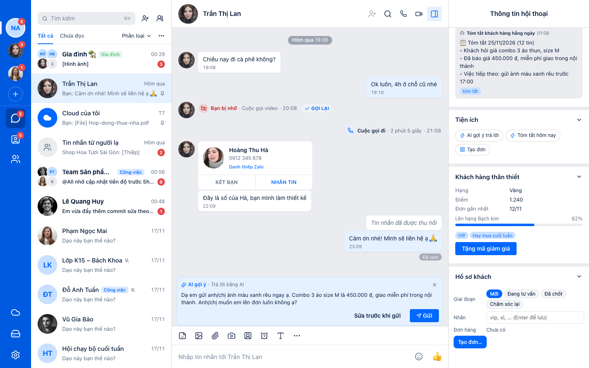
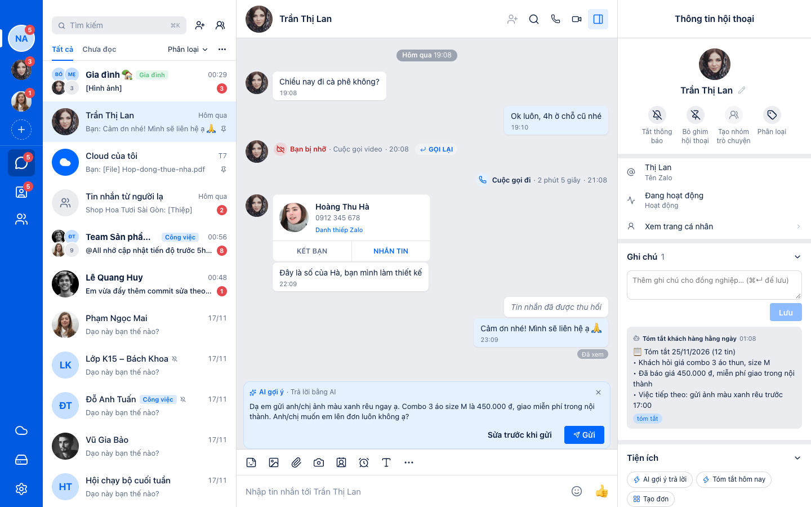
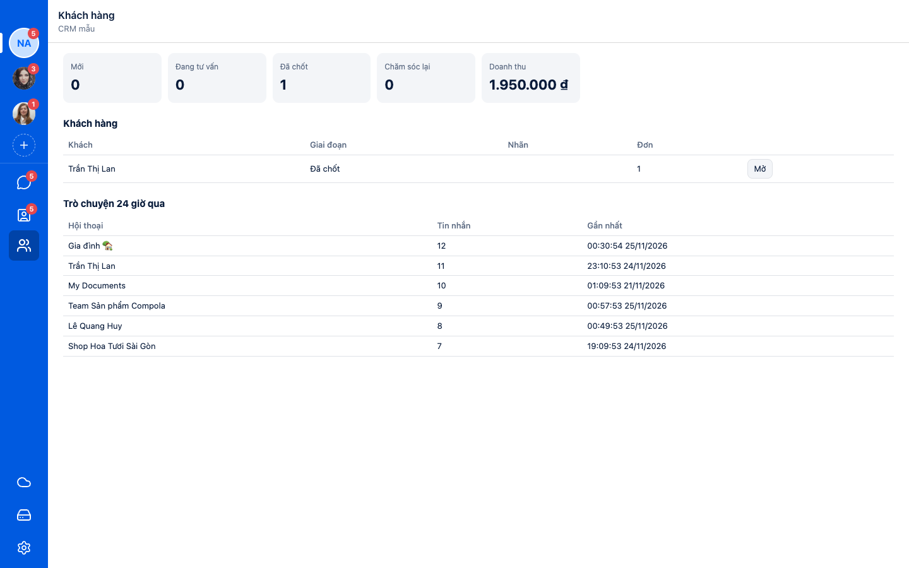
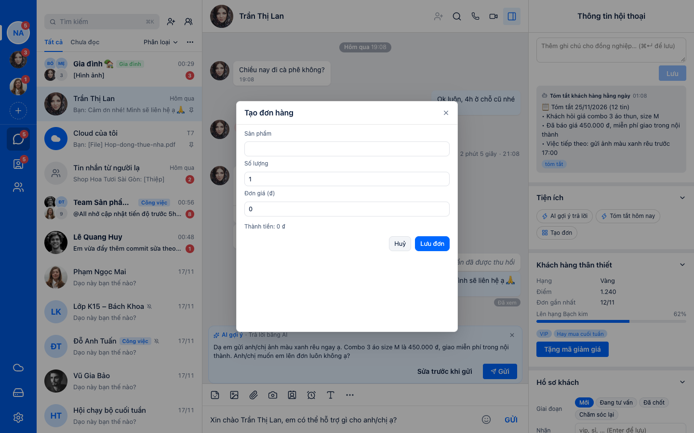

# Add-ons

Add-ons extend Compola. They can read messages, write notes on a conversation, suggest or send replies with AI, add quick
replies, and **show their own HTML UI inside the app** (a sidebar tab, a card in the conversation's info panel, a strip
above the message box, a settings page, or a dialog). Install one from a `.zip` in Settings › Nâng cao › **Add-on**.

| | |
|---|---|
|  |  |
|  |  |

Code: Rust `src-tauri/src/automation/addons/` (package, runtime, host, workspace, views), UI `src/engine/addons.ts`,
`src/features/addons/`, Settings `src/features/settings/AutomationSettings.tsx`. Example: `examples/addons/crm-demo`.

## How it runs

- **Where:** in the Compola core (Rust), not in the window: add-ons keep working when the UI reloads and on a headless
  Compola Server (Linux container). People connected to a Compola Server (desktop or `/web`) see their notes, suggestions
  and views for the conversations they may access.
- **Isolation:** each enabled add-on has its own QuickJS runtime on its own thread. It has no file system, network, or
  process access of its own. Everything goes through `compola.*`, which the host checks against the manifest's
  permissions.
- **Limits:** memory (`limits.memoryMb`, default 64 MB, max 256). CPU per turn (`limits.timeoutMs`, default 5 s): a
  runaway loop is stopped. Event queue: 1,000 events, then the oldest are dropped and counted. At most 256 calls waiting at
  once. Storage: 5 MB. Per-add-on rate limits set by the user: messages/minute, messages/conversation/hour, AI requests/hour,
  network requests/minute. All add-ons together may send at most 60 messages per minute.
- **Recovery:** a crashed add-on restarts with backoff (1 s … 60 s). After 5 crashes in 10 minutes it stops as *Tạm dừng
  do lỗi* until someone restarts it. Logs: Settings › the add-on › Nhật ký, and `addons-data/<id>/log.txt` (rotated at 1 MB).
- **Updates:** installing the same id replaces it and keeps the previous version (*Khôi phục bản trước*). Settings,
  storage and notes survive updates. Built-in add-ons update with the app.

## Package

```
my-addon.zip
├── manifest.json
├── main.js              backend (QuickJS)
├── lib/util.js          require('./lib/util.js')
├── prompt.md            compola.assets.read('prompt.md')
└── ui/panel.html        HTML view (+ its .css/.js/images, inlined at load)
```

A zip may contain the files at its root or inside one folder. Limits: 2,000 files, 20 MB per file, 64 MB in total. Paths
that leave the package are refused. A single `.js` file with a `/* @compola-addon {manifest} */` comment also installs.
To build a zip: `scripts/pack-addon.sh <folder>`.

```json
{
  "id": "my-addon", "name": "Của tôi", "version": "1.0.0", "description": "…", "author": "…", "main": "main.js",
  "permissions": ["messages:read", "messages:send", "notes", "ui", "ai", "schedules", "mcp", "network", "notifications"],
  "hosts": ["api.example.com", "*.example.org"],
  "settings": [
    { "key": "tone", "label": "Giọng văn", "type": "text", "default": "thân thiện" },
    { "key": "mode", "label": "Chế độ", "type": "select", "options": [{ "value": "a", "label": "A" }], "default": "a" }
  ],
  "contributes": {
    "views": [{ "id": "panel", "title": "Khách hàng", "location": "inspector", "entry": "ui/panel.html", "height": 300 }],
    "actions": [{ "id": "summarize", "title": "Tóm tắt", "context": "conversation" },
                { "id": "order", "title": "Tạo đơn", "context": "conversation", "view": "order-form" }],
    "quickReplies": [{ "shortcut": "chao", "text": "Xin chào {{name}}" }]
  },
  "limits": { "memoryMb": 64, "timeoutMs": 5000 }
}
```

Setting types: `text`, `textarea`, `number`, `boolean`, `select` (`options`), `secret`, `time` (HH:MM), `conversation`,
`conversations` (a list), `cron`, `url` (its host becomes reachable with `network`: a webhook address the user types in).

### Permissions

| Permission | Allows |
|---|---|
| `messages:read` | `message` events, `conversations`, `messages`, `history`, `activeConversations`, `search`, `accounts` |
| `messages:send` | `sendText` (rate-limited), only into a conversation that wrote in the last 24 hours, one the user picked in the add-on's `conversation` / `conversations` settings, or one where a person used the add-on in the last hour |
| `notes` | `notes.*`: comments on a conversation, shown in its info panel |
| `ui` | `ui.suggest`, `ui.panel`, `ui.toast`, `ui.openView`, `quickReplies.set`, `actions.set`, `views.*`, HTML views |
| `ai` | `ai.complete` through the provider set in Settings (the add-on never sees the API key) |
| `schedules` | its own cron or one-time schedules (`schedule` event) |
| `mcp` | external MCP servers configured in Settings |
| `network` | `fetch` to `hosts` and to the hosts of the add-on's `url` settings, nothing else (required: a manifest with `network` but no `hosts` and no `url` setting is refused). Never to loopback or private addresses; the connection goes to the addresses that were checked, and each redirect is checked again. Responses up to 10 MB |
| `notifications` | system notifications |

## Data protection

An add-on reads what its permissions allow; what matters is where it could carry it. Compola closes every way out
except the ones the manifest declares, and Settings shows the result on each card and before install: **🔒 Không gửi
dữ liệu ra ngoài**, or **Có thể gửi ra: …** with the exact channels.

| Way out | How it is closed |
|---|---|
| Network from the backend | No socket or HTTP of its own (QuickJS, no I/O). `fetch` only with `network`, only to declared hosts / hosts of `url` settings (which have no default: only a person fills them in); private and loopback addresses refused unless the person typed that host into a `url` setting (a CRM on the office network), DNS pinned (no rebinding), redirects re-checked |
| Zalo messages | `sendText` only with `messages:send`, only to the conversations above (not to an arbitrary contact), rate-limited per add-on, per conversation and for all add-ons together |
| MCP servers | Only with `mcp` (the servers the user configured), shown as a way out |
| AI | Only to the provider the user set (the add-on never sees the key or the URL, and cannot add tools to the request) |
| HTML views | Sandboxed `srcdoc` iframe, opaque origin. CSP first in the document: no `connect-src`, no forms, no workers beyond `blob:`, images/media only from `data:`/`blob:` (plus the add-on's own hosts with `network`). The app's `frame-src` stops a view from navigating itself to another address with data in the URL. Nested frames, `<object>`/`<embed>` and connection hints (`preconnect`, `dns-prefetch`, `prefetch`) are stripped from the markup and removed at runtime; DNS prefetching is off; WebRTC (`RTCPeerConnection`) is removed |
| Other add-ons, the app | Each add-on has its own runtime, storage and notes; views cannot reach the app, its storage or Tauri |
| Notes, panels, suggestions | Plain text in the UI (no HTML, no remote images) |
| Updates | An update that adds permissions or hosts lists them before it installs |
| Browser sign-in | `compola.auth.browser` opens only an address the add-on may reach, after a native dialog that names the add-on and the host; the redirect comes back to a one-time 127.0.0.1 port (not on Compola Server, which has no browser) |

Residual risk worth knowing: a person can always be persuaded to send a suggestion or a reply an add-on prepared, and an
add-on with `messages:send` may answer anyone who wrote in the last day. Install add-ons from sources you trust.

## Backend API (`main.js`)

```js
compola.on('message', async (m) => {})   // {account, id, conversationId, conversationName, isGroup, senderName, fromMe,
                                          //  sentBy ('addon:<id>' when an add-on sent it, else null), text, date, source}
compola.on('ready' | 'settings' | 'unload' | 'schedule' | 'action' | 'suggestion' | 'note', fn)
// action: {actionId, account, conversationId, messageId, text, payload, user:{kind,id,name}}
// suggestion: {id, outcome: used|sent|dismissed, conversationId, text, user}

await compola.sendText(conversationId, text, { account })   // account: optional, found from the conversation
await compola.conversations({ query, limit, unread, account })
await compola.messages(conversationId | null, limit)         // what Compola currently has in memory
await compola.history(conversationId, { since, until, limit }) // persisted index, oldest first
await compola.activeConversations({ since, limit })          // [{id, name, isGroup, count, lastDate, account}]
await compola.search(query, { conversationId, limit, context })
await compola.accounts()

await compola.notes.add(conversationId, text, { pinned, tags, key, messageId })  // `key`: one note per key, updated in place
await compola.notes.list(conversationId) / notes.update(id, {text, pinned, tags}) / notes.remove(id)  // own notes only

await compola.ui.suggest(conversationId, text, { title, id, ttlMinutes })  // reply card above the composer
await compola.ui.clearSuggestions(conversationId)
await compola.ui.panel(conversationId | null, { title, blocks: [...] })      // null: every conversation
await compola.ui.toast(text, { conversationId, level })
await compola.ui.openView(viewId, { conversationId, params })
await compola.quickReplies.set([{ shortcut, title, text }])
await compola.actions.set([{ id, title, context }])

await compola.ai.available()
await compola.ai.complete({ system, prompt | messages, maxTokens, effort, json })  // → {text, json?, model, usage}

compola.views.handle(name, async (data, ctx) => result)  // answers compola.call(name, data) from a view
await compola.views.post(name, data, { viewId, conversationId })  // to open views: compola.on(name, fn) there

compola.storage.get(key) / storage.all() / await storage.set(key, value) / storage.remove(key)
compola.assets.read('prompt.md');  require('./lib/util.js')
await fetch(url, { method, headers, body, timeoutMs })     // `network`: `hosts` + hosts of `url` settings only
// Sign in to a service through the browser (OAuth 2 + PKCE), `network`:
const { id, redirectUri } = await compola.auth.loopback()   // http://127.0.0.1:<port>/callback, one-time
const { params } = await compola.auth.browser(id, authorizeUrl)  // asks the person, opens the browser (a host the
                                                            // add-on may reach), waits ≤ 5 min: {code, state} | {error}
await compola.crypto.randomString(48) / compola.crypto.sha256(text, 'base64url' | 'hex')
await compola.schedules.save({ cron | at, name, payload }) / list() / remove(id) / runNow(id)
await compola.mcp.servers() / mcp.tools(id) / mcp.call(id, tool, args)
compola.tools.register({ name, description, inputSchema }, handler)   // offered to AI apps by Compola's MCP server
compola.log / warn / error, console.*, setTimeout / setInterval / clearTimeout / clearInterval
```

Panel blocks (no HTML): `{type:'text', text, muted}`, `{type:'heading', text}`, `{type:'kv', items:[{label,value}]}`,
`{type:'list', items, ordered}`, `{type:'badges', items}`, `{type:'progress', label, value 0..1}`,
`{type:'button', label, action, payload, style:'primary'}` (sends an `action` event), `{type:'divider'}`.

## HTML views

`contributes.views[]`: `{id, title, location, entry, icon?, height?, width?}`

| location | Where |
|---|---|
| `tab` | an icon in the left rail, a full page (`icon`: chart, users, calendar, bot, ai, list, grid, file, note, cart, star, zap…) |
| `inspector` | a section of the conversation's info panel (grows with its content up to `height`) |
| `composer` | a strip above the message box |
| `settings` | the add-on's card in Settings › Add-on |
| `modal` | a dialog opened by an action with `"view"`, by `compola.ui.openView`, or by another view |

The entry HTML and its relative `<script src>`, `<link rel=stylesheet>`, images and CSS `url()` are inlined into one
document, shown in `<iframe sandbox="allow-scripts allow-forms">`. The view has an opaque origin, so it cannot reach the
app, its storage or Tauri. Its CSP blocks the network, and remote images are allowed only from the add-on's own hosts when
it has `network`. A view gets data only through its add-on, so it can do exactly what the add-on's permissions allow.
Remote `<script src>` is dropped: bundle libraries into the package. `<iframe>`, `<object>`, `<embed>` and WebRTC are
not available (see *Data protection*). The view runs in every Compola UI (host, joined app, web client).

Injected in every view (`window.compola`):

```js
compola.ready((ctx) => {})   // ctx: {addonId, viewId, location, account, conversationId, conversationName, isGroup, theme, params}
compola.context
await compola.call(name, data)          // → the add-on's compola.views.handle(name, fn)
compola.on('context', fn)               // another conversation, theme change
compola.on(name, fn)                    // compola.views.post(name, data) from the add-on
await compola.toast(text)
await compola.insertText(text)          // into the message box of the view's conversation (not sent)
await compola.openConversation(id)
await compola.openView(viewId, params)  // a modal view of the same add-on
compola.resize(height); compola.close(result)
```

Base styles follow the app's light/dark theme. CSS variables: `--c-bg --c-fg --c-muted --c-border --c-accent
--c-accent-fg --c-surface --c-danger --radius`. A `button.primary` class is provided.

## Built-in add-ons

Installed disabled:

- **Trả lời bằng AI**: drafts a reply from the conversation history and your company info. *Suggest* mode leaves a card
  above the composer for staff (Gửi / Sửa / ✕). *Auto* mode sends only when the AI is confident and no human is needed,
  within working hours. It waits until the customer stops typing. It stands back for a while after a person replies. Some
  keywords (khiếu nại, hoàn tiền…) are handed to a person with a note and a notification.
- **Tóm tắt khách hàng hằng ngày**: on a schedule, one summary note per conversation with messages that day (AI or
  plain). Optionally sends a report to a conversation. Also has the action *Tóm tắt hôm nay* and the MCP tool
  `summarize_conversation`.
- **Tin nhắn nhanh**: `/shortcut | text` lines become quick replies (type `/` in the message box).
- **Khách đang chờ** (`reply-radar`): customers whose last message is still unanswered, longest wait first (a tab), a
  panel with the wait time, a notification after N minutes within working hours. Nothing leaves Compola.
- **Thống kê tin nhắn** (`insights`): a dashboard tab (today vs. yesterday, 7/14/30-day in/out chart, busiest
  weekday × hour heatmap, top conversations, median response time) and per-conversation stats in the info panel.
  Nothing leaves Compola.
- **Sổ đơn hàng** (`order-book`): *Tạo đơn* opens an order form the AI fills in from the chat (name, phone, address,
  items, shipping); saved orders become a pinned note, show in the info panel and in an *Đơn hàng* tab with statuses,
  search, revenue and CSV. *Lưu và chèn xác nhận* puts a confirmation in the message box.
- **Dịch nhanh** (`translator`): a strip above the message box translates what you write into the customer's language
  (detected per conversation) and inserts it; *Dịch tin gần đây* and the info panel translate the customer's messages.
- **Nhiệt kế khách hàng** (`mood-meter`): after a customer stops typing, AI rates their mood (−2…+2) with a reason;
  a panel, an info-panel gauge with history, a tab of unhappy customers first, and a notification for urgent ones.
- **Gửi sang Webhook** (`webhook`): posts messages as JSON to the https address you enter (n8n, Make, Zapier, Apps
  Script, a CRM), with a retrying queue and a status page in its settings. The only add-on here that sends data out,
  and only to that address.
- **Trả lời tự động**, **Cảnh báo từ khoá**, **Tóm tắt hằng ngày**: as before.

Built-ins live in `src-tauri/addons/<id>/` (every file is bundled, HTML views included). `cargo test --lib builtin`
boots each one in the real runtime with sample data (`COMPOLA_SMOKE=<ids>` to pick some). In the browser preview
(`npm run dev`, `?mock=1`) the built-ins with views run for real in Web Workers with canned AI answers
(`src/engine/mock/features/builtinAddons.ts`).

## AI provider

Settings › Add-on › *AI cho add-on*: Claude (Anthropic Messages API, default model `claude-opus-5-5`, effort low / medium /
high, server-side refusal fallback on supported models), or any OpenAI-compatible `/chat/completions` (Ollama, LM Studio,
vLLM). One key for all add-ons, stored in `automation.json` (0600). *Lưu và thử* sends a one-word test request.

## Compola Server

Every workspace command is checked against the user's access (`remote/policy.rs`). Notes, suggestions, actions and view
calls need write access to the conversation. Views and actions with no conversation need access to every conversation.
Installing, enabling, configuring or removing add-ons is for admins only, because it runs code on the server. Events are
filtered per user by conversation.
