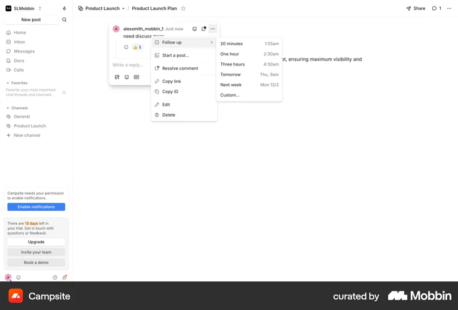
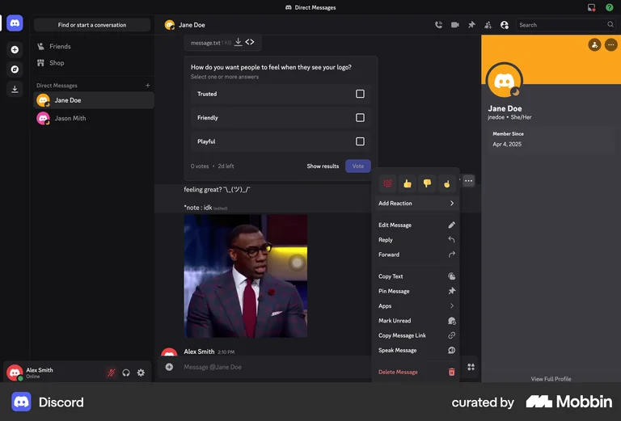
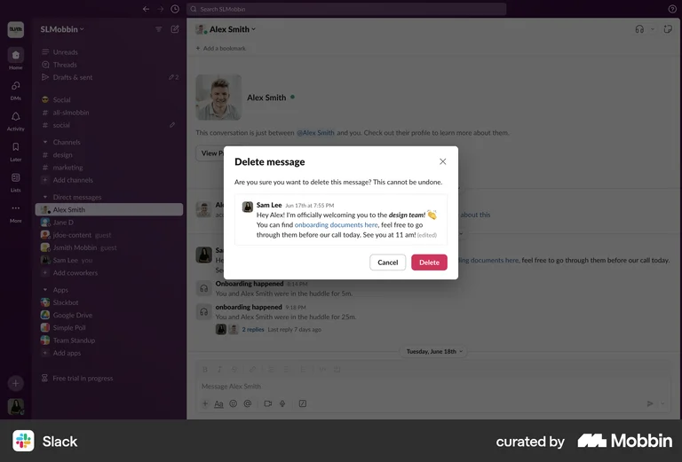
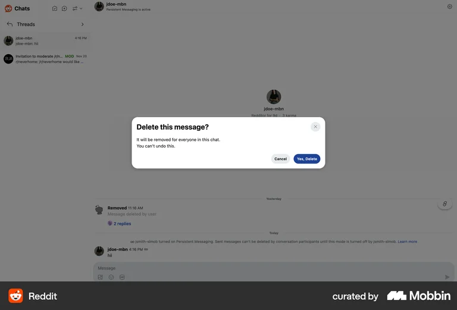
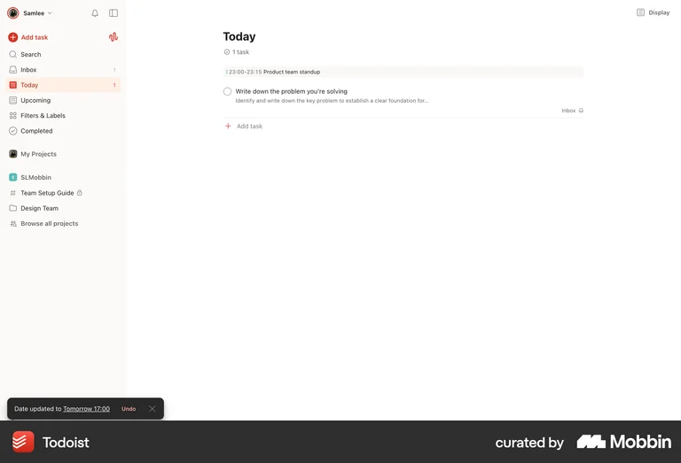

# Wave 4 — shared overlays (menus, dialogs, popovers, toasts)

Shared components in `src/ui/*` (`Menu`, `Sheet` / `SheetHeader` / `Alert` / `Popover`, `ToastView`). Applied within
`docs/zalo-pc-style.md`: flat white surfaces, 8px radius, a hairline border + soft shadow, `--hover` rows, `--danger`
destructive actions, Hủy + the primary action bottom-right.

| Reference | Takeaway |
|---|---|
|  [Campsite — message menu with submenu](https://mobbin.com/screens/2f32f194-9690-4f68-9e6c-7cf89f88c572) | Leading icons in one column, 32px rows, a chevron for submenus, the submenu opens flush beside its row. |
|  [Discord — message context menu](https://mobbin.com/screens/3bb788dd-b0b0-4d0b-9713-0c2617017466) | Reaction row on top, grouped sections with separators, the destructive action last and red (text + icon). |
|  [Slack — delete message dialog](https://mobbin.com/screens/b4ca939d-97db-404a-9736-fe181dcf56f0) | Left-aligned title with ×, a plain sentence, Cancel (neutral) + a filled red Delete bottom-right. |
|  [Reddit — delete message dialog](https://mobbin.com/screens/3e6146c5-c957-4098-82a9-56ee40cc990e) | Compact confirm (~400px), the question as the title, the consequence as one line, buttons right-aligned. |
|  [Todoist — undo toast](https://mobbin.com/screens/75c4093b-73e7-4344-b2e7-54e90d94e58c) | A dark pill with the result + an inline accent "Hoàn tác"-style action; it disappears on its own. |

Applied:
- **Menus:** icons lead (one aligned column; rows without an icon keep the text aligned), 32px rows, the check column
  only when a menu has checkable items, muted shortcuts / chevrons, destructive rows red, a 1px border + soft shadow,
  submenus flush with their row.
- **Alert:** Zalo PC confirm: a left-aligned title row with × (= the cancel button), the message, then the buttons in
  one row bottom-right — cancel neutral on the left, the action filled (blue, or red when destructive).
- **Sheet / SheetHeader / Popover:** flat white, 8px radius, a hairline border; the sheet title bar 48px with a 16px
  semibold title.
- **Toast:** a bottom-centre dark pill with an optional action (`showToast(text, conversationId, { label, run })`).
